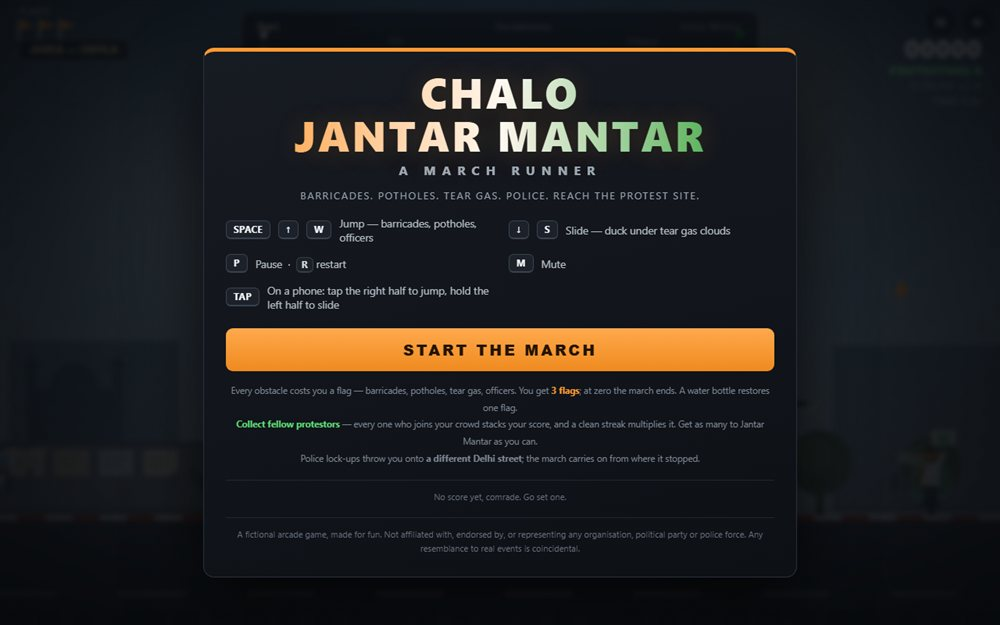

# Chalo Jantar Mantar - March Runner

A canvas march runner: keep the crowd moving, dodge the barricades, and chase a high score.

**[Open the live site](https://ajeet-iitk.github.io/JantarMantar3/)**

## What it does

A small browser game built around a march at Jantar Mantar. The scene scrolls on a `<canvas>`, sound is generated on the fly with the Web Audio API (no audio files are shipped), and the best score is kept in `localStorage`.

## Features

- Canvas rendering driven by `requestAnimationFrame`
- Procedural sound effects through `AudioContext`
- Best score persisted in `localStorage`
- Keyboard controls, no dependencies, no build step

## Run locally

Open `index.html` in a browser, or play the hosted build:

<https://ajeet-iitk.github.io/JantarMantar3/>

## Files

| File | Purpose |
| --- | --- |
| `index.html` | Landing page |
| `chalo-jantar-mantar.html` | The game itself |

## Variants

This is one of three tuning variants of the same game - see `JantarMantar1`, `JantarMantar2` and `JantarMantar3` for different feels.

---

Part of [my collection of small projects](https://github.com/Ajeet-iitk).
